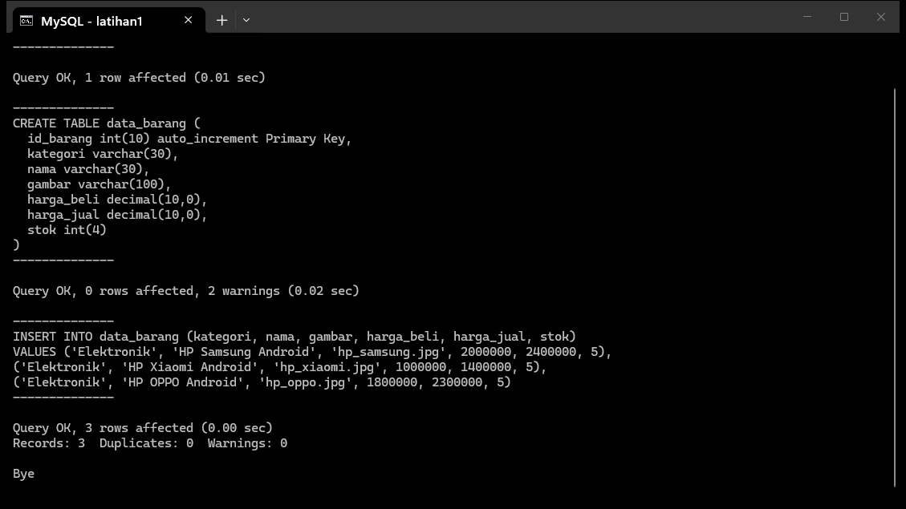
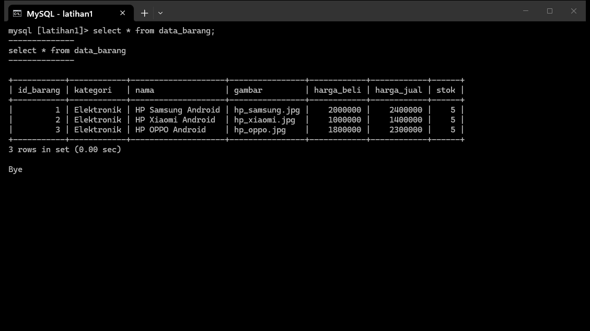
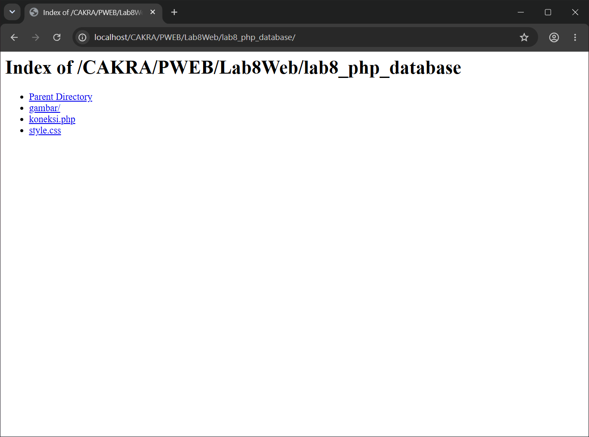
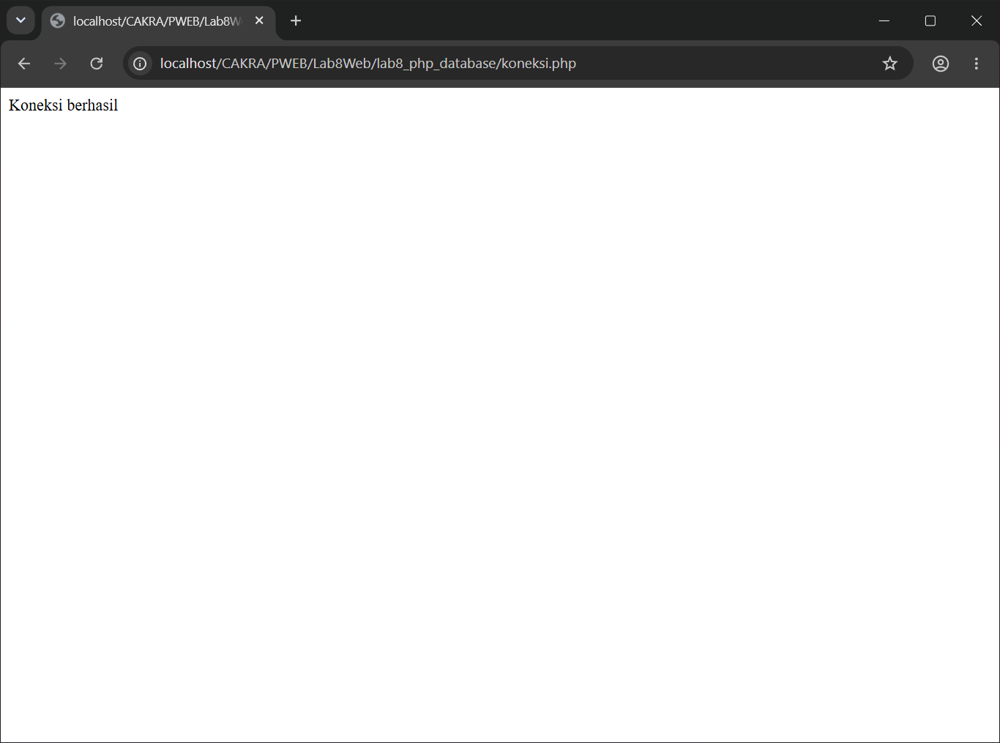
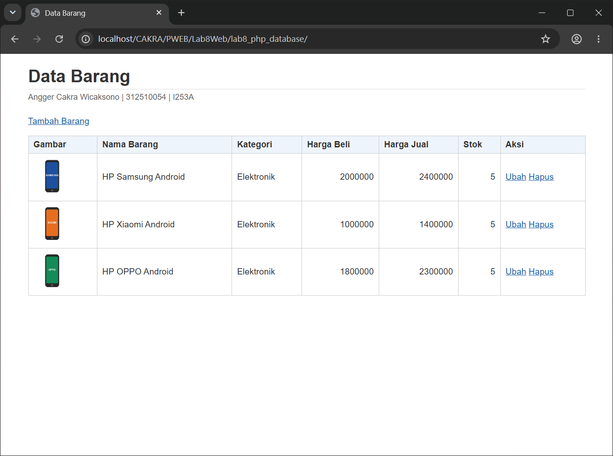
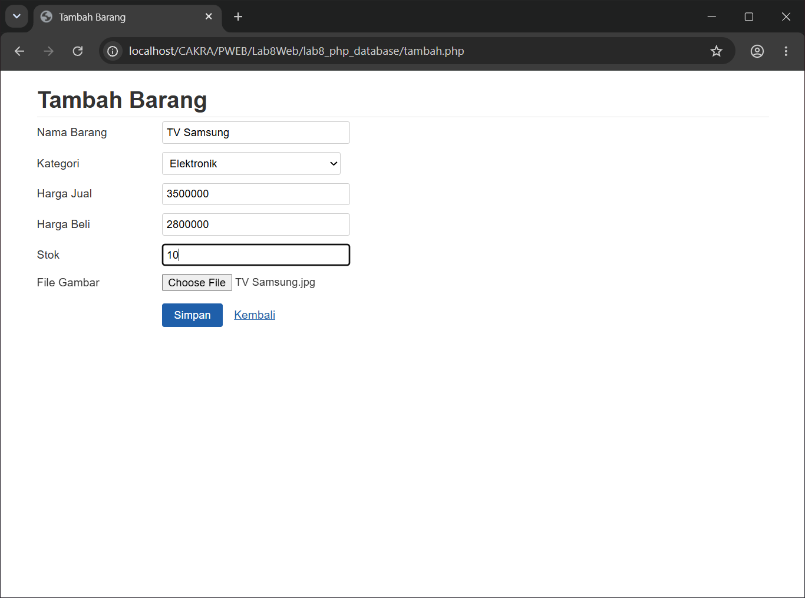
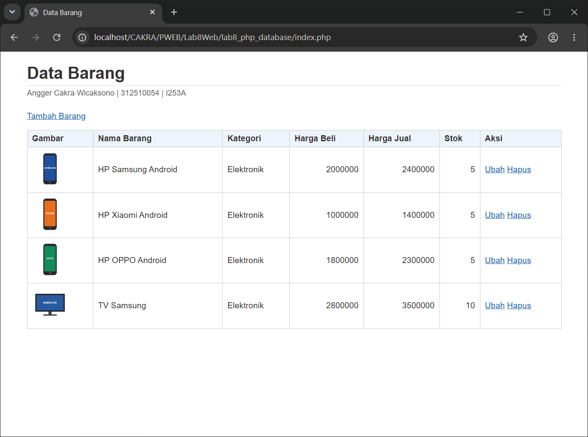
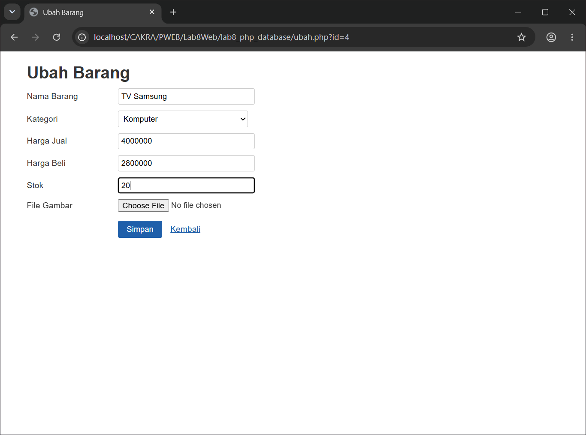
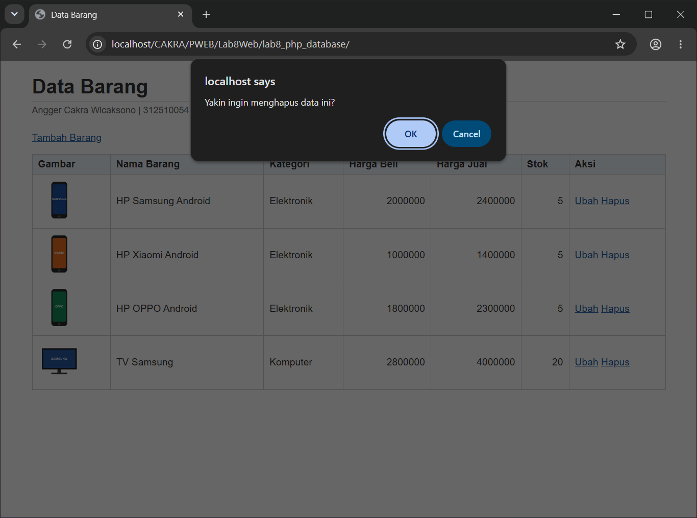
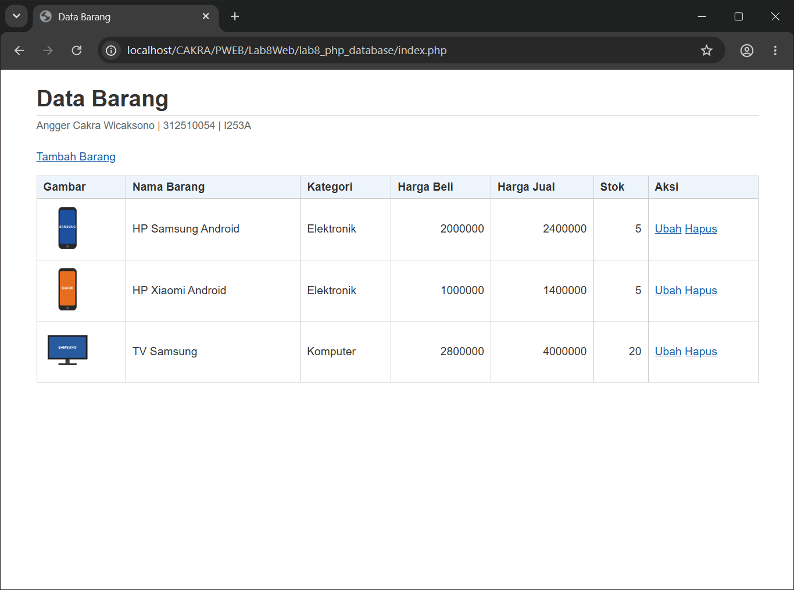

# Praktikum 8: PHP dan Database MySQL

Repository ini dibuat untuk memenuhi tugas **Praktikum 8 - PHP dan Database MySQL** pada mata kuliah Pemrograman Web.

**Identitas Mahasiswa:**
- **Nama:** Angger Cakra Wicaksono
- **NIM:** 312510054
- **Kelas:** I253A
- **Program Studi:** Teknik Informatika
- **Dosen Pengampu:** Agung Nugroho, S.Kom., M.Kom.
- **Kampus:** Universitas Pelita Bangsa

---

## Tujuan Praktikum

1. Mahasiswa mampu memahami konsep dasar Database.
2. Mahasiswa mampu memahami konsep dasar CRUD menggunakan PHP.
3. Mahasiswa mampu membuat program CRUD sederhana menggunakan PHP.

---

## Perangkat

- Laragon (Apache 2.4.58, PHP 8.3, MySQL 8.0.30), dipakai sebagai pengganti XAMPP pada modul
- MySQL client (command line) bawaan Laragon
- Visual Studio Code
- Google Chrome

---

## Panduan Screenshot

| No File | Langkah | Yang Ditampilkan |
|---|---|---|
| **`1.png`** | Membuat database dan tabel | Hasil `CREATE DATABASE latihan1`, `CREATE TABLE data_barang`, dan `INSERT` 3 data barang di MySQL client. |
| **`2.png`** | Menampilkan data | Hasil `select * from data_barang;` berisi 3 data. |
| **`3.png`** | Folder lab8_php_database | Tampilan `http://localhost/.../lab8_php_database/` sebelum `index.php` dibuat (Index of). |
| **`4.png`** | Tes koneksi | `koneksi.php` menampilkan "Koneksi berhasil". |
| **`5.png`** | Read | `index.php` menampilkan data barang beserta gambar. |
| **`6.png`** | Create | Form Tambah Barang diisi data TV Samsung dan file gambar. |
| **`7.png`** | Create | Data TV Samsung berhasil ditambahkan. |
| **`8.png`** | Update | Form Ubah Barang untuk TV Samsung (kategori, harga jual, stok diubah). |
| **`9.png`** | Update | Data TV Samsung setelah diubah. |
| **`10.png`** | Delete | Konfirmasi hapus data HP OPPO Android. |
| **`11.png`** | Delete | Data HP OPPO Android sudah terhapus. |

---

## Struktur Folder

```text
Lab8Web/
├── .gitignore
├── README.md
├── index.html
├── database.sql            (script database dari modul)
├── screenshots/
│   ├── 1.png
│   ├── ...
│   └── 11.png
└── lab8_php_database/
    ├── koneksi.php
    ├── index.php           (Read)
    ├── tambah.php          (Create)
    ├── ubah.php            (Update)
    ├── hapus.php           (Delete)
    ├── style.css
    └── gambar/
        ├── hp_samsung.jpg
        ├── hp_xiaomi.jpg
        ├── hp_oppo.jpg
        └── TV_Samsung.jpg  (hasil upload saat uji tambah data)
```

---

## Cara Menjalankan

1. Buka Laragon, klik **Start All** sampai Apache dan MySQL berjalan.
2. Import database dengan menjalankan `database.sql`, misalnya melalui terminal Laragon:
   ```text
   mysql -u root < database.sql
   ```
3. Buka `http://localhost/CAKRA/PWEB/Lab8Web/lab8_php_database/` di browser.

---

## Langkah-langkah Praktikum

### 1. Menjalankan MySQL Server
Modul menggunakan XAMPP Control Panel. Pada praktikum ini dipakai **Laragon**, sehingga Apache dan MySQL cukup dijalankan dengan tombol **Start All**.

Laragon yang dipakai tidak menyertakan phpMyAdmin, dan Adminer bawaannya tidak bisa login dengan user `root` tanpa password. Karena itu perintah SQL dijalankan menggunakan **MySQL client (command line)**, sama seperti tampilan Gambar 8.4 pada modul.

---

### 2. Membuat Database dan Tabel
Struktur tabel `data_barang`:

| Nama Field | Tipe Data | Ukuran | Keterangan |
|---|---|---|---|
| id_barang | INT | 10 | Primary Key, Auto Increment |
| kategori | VARCHAR | 30 | |
| nama | VARCHAR | 30 | |
| gambar | VARCHAR | 100 | |
| harga_beli | DECIMAL | 10,0 | |
| harga_jual | DECIMAL | 10,0 | |
| stok | INT | 4 | |

```sql
CREATE DATABASE latihan1;

CREATE TABLE data_barang (
  id_barang int(10) auto_increment Primary Key,
  kategori varchar(30),
  nama varchar(30),
  gambar varchar(100),
  harga_beli decimal(10,0),
  harga_jual decimal(10,0),
  stok int(4)
);

INSERT INTO data_barang (kategori, nama, gambar, harga_beli, harga_jual, stok)
VALUES ('Elektronik', 'HP Samsung Android', 'hp_samsung.jpg', 2000000, 2400000, 5),
('Elektronik', 'HP Xiaomi Android', 'hp_xiaomi.jpg', 1000000, 1400000, 5),
('Elektronik', 'HP OPPO Android', 'hp_oppo.jpg', 1800000, 2300000, 5);
```

Pada MySQL 8, perintah `CREATE TABLE` menghasilkan 2 warning karena penulisan lebar tampilan seperti `int(10)` dan `int(4)` sudah tidak dianjurkan. Tabel tetap berhasil dibuat.




---

### 3. Membuat Folder Program CRUD
Folder `lab8_php_database` dibuat di dalam document root Laragon (`C:\laragon\www\...`), lalu diakses melalui browser. Sebelum `index.php` dibuat, Apache menampilkan daftar file di folder tersebut.



---

### 4. Membuat File Koneksi Database
File `koneksi.php` menghubungkan PHP ke database `latihan1` menggunakan `mysqli_connect()`:

```php
<?php
$host = "localhost";
$user = "root";
$pass = "";
$db   = "latihan1";

$conn = mysqli_connect($host, $user, $pass, $db);
if ($conn == false)
{
    echo "Koneksi ke server gagal.";
    die();
} #else echo "Koneksi berhasil";
?>
```

Untuk pengujian, baris `echo "Koneksi berhasil"` di-uncomment sementara dan halaman menampilkan "Koneksi berhasil". Setelah itu baris tersebut dijadikan komentar lagi agar tulisan tidak muncul di setiap halaman yang meng-include `koneksi.php`.



---

### 5. Menampilkan Data / Read (`index.php`)
Data diambil dengan query `SELECT * FROM data_barang`, lalu ditampilkan baris per baris dengan `mysqli_fetch_array()` di dalam perulangan `while`. Setiap baris memiliki link **Ubah** dan **Hapus**, dan di atas tabel ada link **Tambah Barang**.

```php
$sql = 'SELECT * FROM data_barang';
$result = mysqli_query($conn, $sql);
...
<?php while($row = mysqli_fetch_array($result)): ?>
<tr>
    <td>" alt="<?= htmlspecialchars($row['nama']);?>"></td>
    <td><?= htmlspecialchars($row['nama']);?></td>
    ...
    <td>
        <a href="ubah.php?id=<?= $row['id_barang'];?>">Ubah</a>
        <a href="hapus.php?id=<?= $row['id_barang'];?>" onclick="return confirm('Yakin ingin menghapus data ini?')">Hapus</a>
    </td>
</tr>
<?php endwhile; ?>
```



---

### 6. Menambah Data / Create (`tambah.php`)
Form menggunakan `enctype="multipart/form-data"` agar file gambar bisa diupload. Saat tombol Simpan ditekan, file gambar dipindahkan ke folder `gambar/` dengan `move_uploaded_file()`, spasi pada nama file diganti `_`, lalu data disimpan dengan query `INSERT`.

```php
$filename = str_replace(' ', '_',$file_gambar['name']);
$destination = dirname(__FILE__) .'/gambar/' . $filename;
if(move_uploaded_file($file_gambar['tmp_name'], $destination))
{
    $gambar = $filename;
}
$sql = 'INSERT INTO data_barang (nama, kategori,harga_jual, harga_beli, stok, gambar) ';
$sql .= "VALUE ('{$nama}', '{$kategori}','{$harga_jual}', '{$harga_beli}', '{$stok}', '{$gambar}')";
```

**Pengujian:** menambah barang **TV Samsung** (Elektronik, harga jual 3.500.000, harga beli 2.800.000, stok 10) dengan file `TV Samsung.jpg`. File tersimpan sebagai `TV_Samsung.jpg`, dan data baru langsung tampil di halaman index.




---

### 7. Mengubah Data / Update (`ubah.php`)
Halaman ubah menerima `id` dari URL (`ubah.php?id=4`), mengambil data barang tersebut, lalu menampilkannya di form. Function `is_select()` dipakai agar kategori yang tersimpan otomatis terpilih. Jika file gambar tidak diganti, kolom gambar tidak ikut diupdate.

```php
function is_select($var, $val) {
    if ($var == $val) return 'selected="selected"';
    return false;
}
...
$sql = 'UPDATE data_barang SET ';
$sql .= "nama = '{$nama}', kategori = '{$kategori}', ";
$sql .= "harga_jual = '{$harga_jual}', harga_beli = '{$harga_beli}', stok = '{$stok}' ";
if (!empty($gambar))
    $sql .= ", gambar = '{$gambar}' ";
$sql .= "WHERE id_barang = '{$id}'";
```

**Pengujian:** data TV Samsung diubah menjadi kategori **Komputer**, harga jual **4.000.000**, dan stok **20** (mengikuti contoh Gambar 8.10 pada modul).




---

### 8. Menghapus Data / Delete (`hapus.php`)
Link Hapus mengirim `id` ke `hapus.php`, lalu data dihapus dengan query `DELETE` dan halaman kembali ke index.

```php
$id = (int) $_GET['id'];
$sql = "DELETE FROM data_barang WHERE id_barang = '{$id}'";
$result = mysqli_query($conn, $sql);
header('location: index.php');
```

Agar data tidak terhapus tidak sengaja, link Hapus diberi konfirmasi JavaScript `confirm()`.

**Pengujian:** menghapus data **HP OPPO Android**. Setelah OK ditekan, data tersebut hilang dari tabel.




---

## Penyesuaian dari Kode Modul

Beberapa bagian kode modul tidak berjalan sesuai harapan saat dicoba, sehingga disesuaikan:

1. **Kolom tabel index:** judul kolom di modul tertulis Harga Jual lalu Harga Beli, sedangkan isinya `harga_beli` lalu `harga_jual`. Urutan judul diperbaiki, dan kolom Aksi diisi link Ubah dan Hapus (di modul berisi `id_barang`). Link Tambah Barang juga ditambahkan seperti pada Gambar 8.8.
2. **Path gambar:** `tambah.php` di modul menyimpan `gambar/namafile`, sedangkan `index.php` menambahkan `gambar/` lagi sehingga gambar tidak muncul. Di database sekarang hanya disimpan nama file, sama seperti data awal (`hp_samsung.jpg`).
3. **`is_select()` pada `ubah.php`:** di modul ketiga option membandingkan dengan `'Komputer'`, sehingga kategori Elektronik dan Hand Phone tidak pernah terpilih. Nilai pembanding disesuaikan dengan option masing-masing.
4. **Keamanan dasar:** `id` dan angka diubah ke integer (`(int)`), teks di-escape dengan `mysqli_real_escape_string()`, dan data ditampilkan dengan `htmlspecialchars()`. Setelah `header('location: index.php')` ditambahkan `exit;`.
